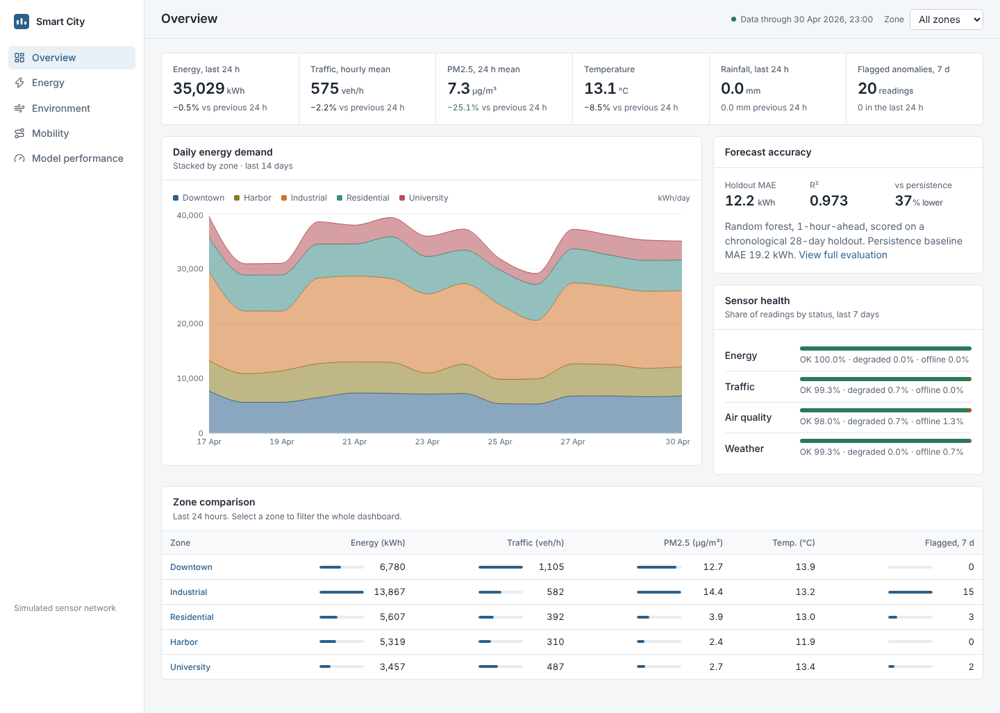
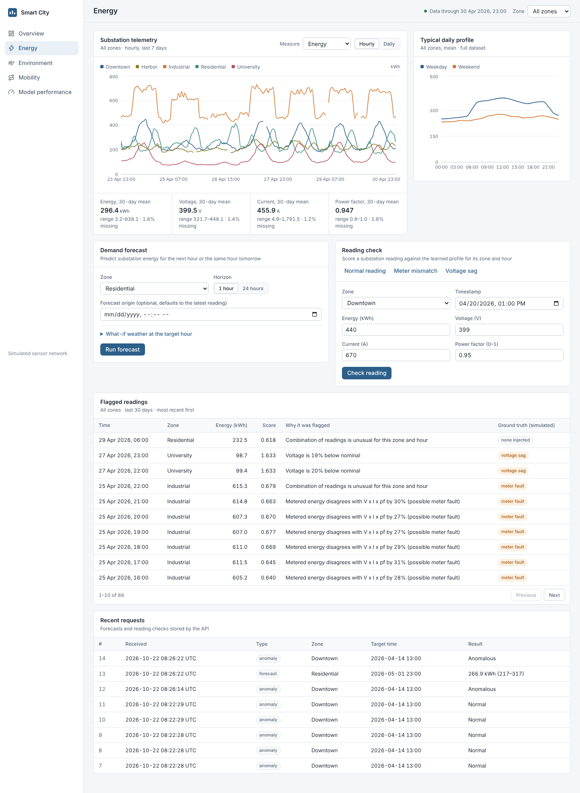
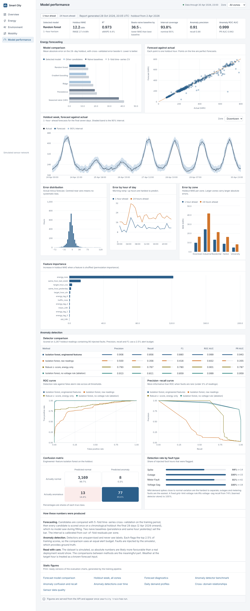
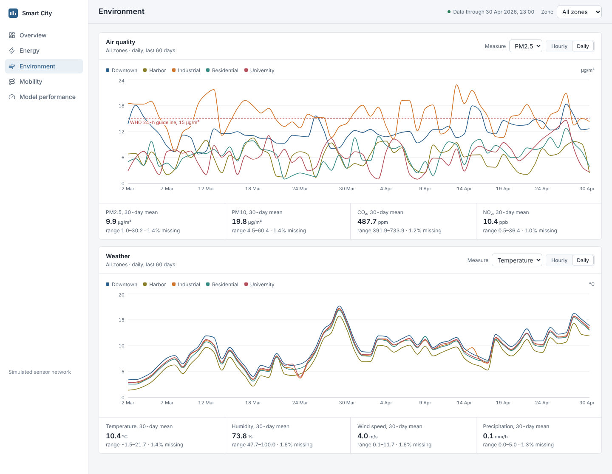
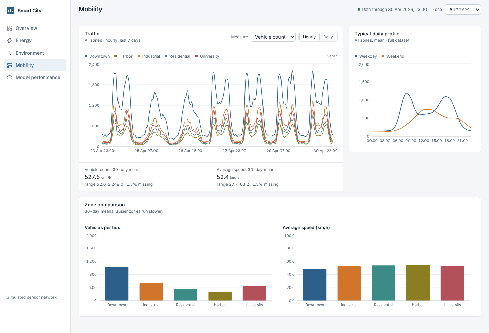

# Smart City Analytics

[](https://github.com/amberley25/Smart_City_Analysis/actions/workflows/ci.yml)

Urban sensor analytics for five city zones: weather, traffic, air quality and substation energy telemetry
in one database, with energy demand forecasting, anomaly detection, a REST API and a React dashboard.



## What it does

- **Links four sensor networks** by zone and hour, so weather can be related to energy and traffic to air quality.
- **Forecasts energy demand** 1 and 24 hours ahead with calibrated 90% intervals, and answers what-if
  questions such as "what happens tomorrow if it drops to -5 C?".
- **Detects grid anomalies** (demand spikes, outages, meter faults, voltage sags) without labels, and says
  why a reading was flagged.
- **Reports its own accuracy.** Every model is scored on a chronological 28-day holdout against naive
  baselines, and the dashboard has a page dedicated to those results.
- **Serves everything over a versioned API** with validation, pagination, structured errors and an audit
  log of every prediction request.

## Results

Measured on the final 28 days, which no model saw during training or selection
(full tables and caveats in [docs/MODEL_CARD.md](docs/MODEL_CARD.md)).

| Task | Selected model | Metric | Result | Best naive baseline |
|---|---|---|---|---|
| Forecast, 1 hour ahead | Random forest | MAE (kWh) | **12.2** (R2 0.973) | 19.2 (persistence) |
| Forecast, 24 hours ahead | Random forest | MAE (kWh) | **20.7** (R2 0.930) | 38.0 (same hour yesterday) |
| Forecast intervals | per-zone residual quantiles | coverage of 90% interval | **93.8%** / **93.8%** | n/a |
| Anomaly detection | Isolation forest + voltage rule | precision / recall / ROC-AUC | **0.91 / 0.86 / 0.999** | 0.50 / 0.36 / 0.832 (raw readings) |


The dataset is **simulated** (see [Data](#data)), so these figures describe the method on that data and
will be lower on real deployments. More charts: [forecast diagnostics](docs/figures/forecast_diagnostics.png),
[holdout week](docs/figures/forecast_backtest.png), [anomaly detail](docs/figures/anomaly_detail.png),
[daily profiles](docs/figures/eda_daily_profiles.png), [cross-domain relationships](docs/figures/eda_relationships.png).

## Quick start

Requires Python 3.11+ and Node 20+.

```bash
make install     # virtualenv, backend and frontend dependencies
make setup       # load the dataset into SQLite, train models, render figures (about a minute)
make serve       # API on http://127.0.0.1:5000
make web         # dashboard on http://localhost:5173 (second terminal)
```

Or with Docker, which trains on first start and serves the dashboard on http://localhost:8080:

```bash
docker compose up --build
```

Without `make`:

```bash
python -m venv .venv && . .venv/bin/activate
pip install -e ".[dev]"
smartcity ingest && smartcity train
smartcity serve
```

## Dashboard

| Energy | Model performance |
|---|---|
|  |  |
| **Environment** | **Mobility** |
|  |  |

## API

```bash
curl -s -X POST localhost:5000/api/v1/energy/forecast \
     -H 'content-type: application/json' \
     -d '{"zone": "Residential", "horizon_hours": 24, "weather": {"temperature_c": -5}}'
```

```json
{
  "zone": "Residential",
  "target_time": "2026-05-01T23:00:00",
  "forecast_kwh": 266.9,
  "interval": { "lower": 217.19, "upper": 316.62, "coverage": 0.9 },
  "model": "Random forest"
}
```

Endpoints cover sensor series (hourly or daily), summaries, daily profiles, an overview, forecasts, anomaly
scoring, flagged history, the prediction log and the evaluation report. See [docs/API.md](docs/API.md).

## Data

No public dataset covers weather, traffic, air quality and substation telemetry for the same zones and
hours, so `backend/smartcity/simulate.py` generates one from a fixed seed: 120 days, hourly, five zones,
57,600 sensor readings. It encodes the couplings a real network shows (heating load follows temperature,
particulates follow traffic and wind), adds realistic sensor faults, and injects 453 labelled hours of grid
anomalies used only for evaluation. The CSVs in `dataset/` are the output, committed so a clone runs
immediately. Details: [docs/DATA.md](docs/DATA.md).

## Development

```bash
make test        # backend (pytest) and frontend (vitest) tests
make lint        # ruff (backend) and oxlint (frontend)
make format
```

The tests cover the simulator's physical invariants, feature leakage, model quality gates, the full API
contract with its error cases and security controls, database idempotence, and the dashboard's API client,
data hook and a form flow. CI runs them on Python 3.11 to 3.13, builds the
dashboard, and smoke-tests the trained API end to end.

## Project layout

```
backend/smartcity/   simulate, features, forecasting, anomaly, pipeline, reporting, db, cli
backend/smartcity/api/   Flask app factory, routes, services
frontend/            React dashboard (Vite, Recharts)
dataset/             simulated sensor data and anomaly labels
docs/                architecture, API, data card, model card, figures, screenshots
tests/               backend test suite
```

Architecture and design decisions: [docs/ARCHITECTURE.md](docs/ARCHITECTURE.md).

## Limitations

- Simulated data; accuracy on real sensors is unproven.
- Four months of history, so there is no summer cooling load and no holiday calendar.
- The 24-hour forecast assumes yesterday's weather unless a forecast is supplied.
- SQLite and a single-node API suit a demonstration or a small deployment, not a metropolitan one.
- No authentication or rate limiting; run behind a gateway.

## License

MIT, see [LICENSE](LICENSE).
