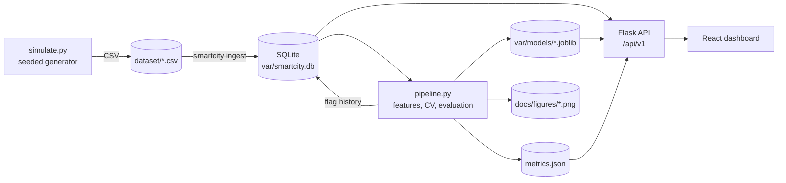

# Architecture

## Layout

| Path | Responsibility |
|---|---|
| `backend/smartcity/simulate.py` | Seeded sensor network: weather, traffic, air quality, substation telemetry, injected faults |
| `backend/smartcity/db.py` | SQLite schema, CSV ingestion, shared query constants |
| `backend/smartcity/features.py` | Leak-free feature construction and the chronological split |
| `backend/smartcity/forecasting.py` | Candidate models, time-series CV, holdout metrics, prediction intervals |
| `backend/smartcity/anomaly.py` | Profile statistics, engineered features, isolation forest plus rule, benchmark |
| `backend/smartcity/pipeline.py` | Orchestrates training, persists models, writes `metrics.json`, scores history |
| `backend/smartcity/reporting.py` | Evaluation and EDA figures |
| `backend/smartcity/api/` | App factory, routes, services (querying, forecasting, scoring) |
| `backend/smartcity/cli.py` | `smartcity simulate / ingest / train / all / serve` |
| `frontend/` | React dashboard (Vite, Recharts) |
| `tests/` | Backend tests, including a leakage test and API contract tests |

## Data flow

1. **Simulate** writes one CSV per sensor network plus a separate ground-truth label file.
2. **Ingest** loads the CSVs into SQLite with `(zone, timestamp)` primary keys. It is idempotent.
3. **Train** reads from SQLite, builds a complete zone-by-hour panel, trains and evaluates both models,
   scores every historical reading for anomalies and writes the results back to the database.
4. **Serve** reads sensor series and anomaly flags from SQLite, loads models lazily (reloading when the
   files change) and logs every forecast and anomaly request to a `prediction_log` table.

## Design decisions

**SQLite.** The workload is read-heavy with one writer (training). SQLite in WAL mode handles that with
zero operational cost and keeps the project runnable from a clone. The access layer is isolated in
`db.py` and `api/services.py`, so moving to PostgreSQL means changing those two modules.

**Time-based evaluation only.** Random splits on time series leak the future into training and
flatter every metric. The split, cross-validation and feature windows are all chronological, and a test
asserts the features at an origin are unaffected by anything after it.

**Baselines are part of the result.** Persistence and seasonal naive forecasts are scored alongside the
learned models, because "R2 = 0.97" means little when persistence already scores 0.96.

**Calibrated uncertainty.** Forecasts carry an interval from per-zone out-of-fold residual quantiles, and
the holdout coverage is reported against the nominal level.

**Hybrid anomaly detection.** A learned detector catches combinations nobody wrote a rule for, and a
deterministic voltage rule covers a failure mode isolation forests handle poorly. Alerts come with
plain-language reasons derived from the same engineered features.

**Everything regenerates.** Models, the database and figures are build outputs (`var/`, git-ignored). The
dataset is committed because it is the project's input and is small.

## Production notes

- Run with `gunicorn "smartcity.api:create_app()"` (see `Dockerfile`), never the Flask development server.
- The API has no authentication or rate limiting. Put it behind a gateway before exposing it.
- Restrict `SMARTCITY_CORS_ORIGINS` to the dashboard's origin.
- For live data, replace the ingest step with a streaming writer into the same tables and schedule
  `smartcity train` for periodic retraining. The API reads the database and model files on each request.
