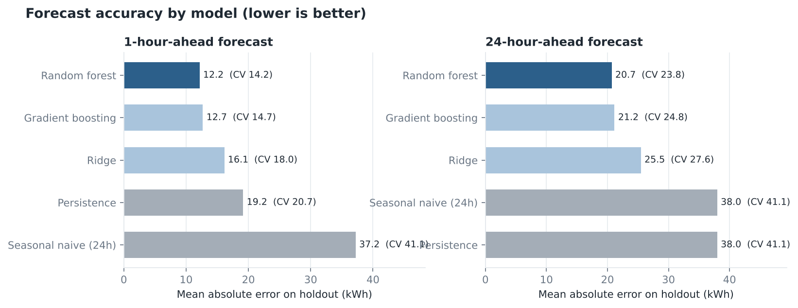
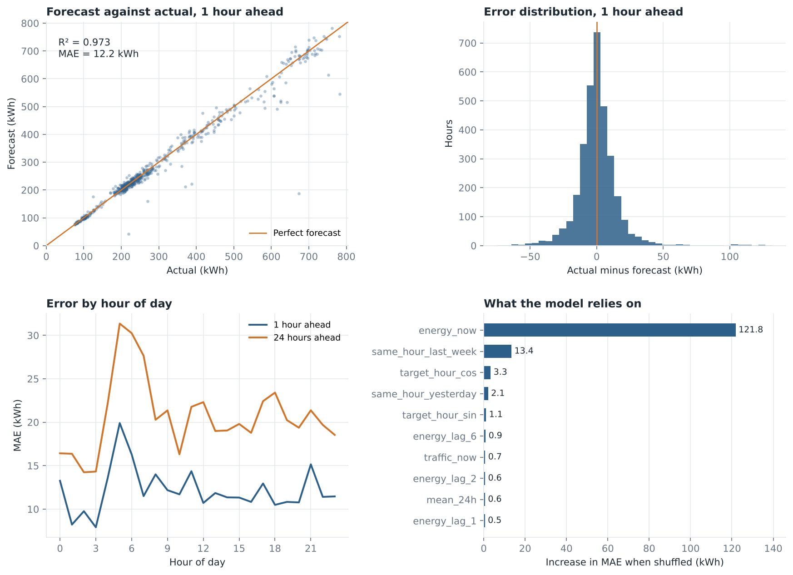
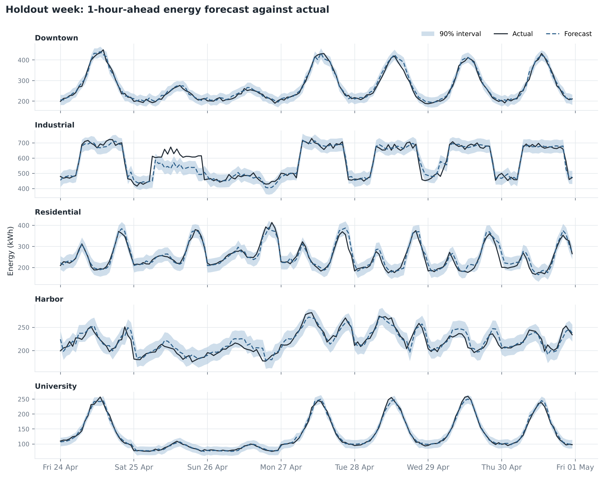
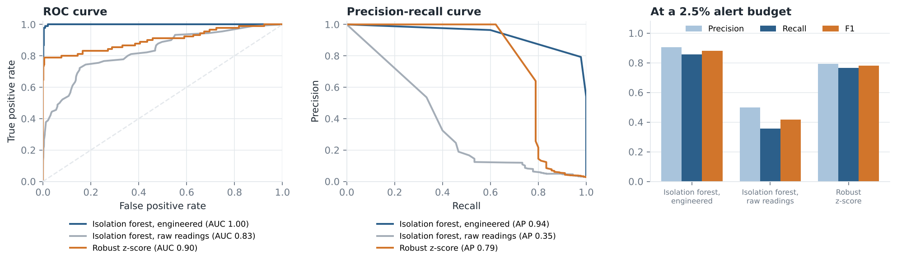
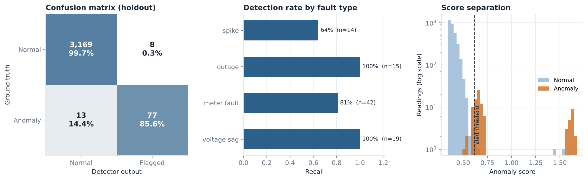
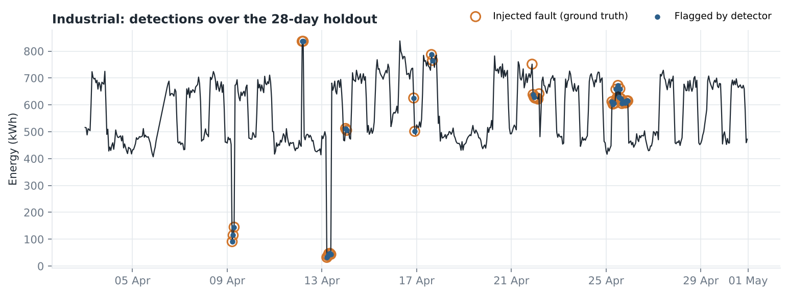

# Model card

Two models are trained by `smartcity train`. Metrics below come from `var/reports/metrics.json`, written
by the same command, and every chart in `docs/figures/` is rendered from that file.

## Evaluation protocol

- **Chronological holdout.** The final 28 days (2026-04-03 to 2026-04-30) are never seen in training or
  model selection. Training targets end before the holdout begins.
- **Model selection** uses 5-fold expanding-window time-series cross-validation on the training period,
  choosing by mean absolute error. There is no shuffling anywhere.
- **Baselines.** Every learned model is compared with persistence ("same as now") and a seasonal naive
  forecast ("same hour yesterday"). A model that cannot beat those is not worth deploying.
- **Leakage test.** `tests/test_features.py` overwrites every future energy and traffic value with garbage
  and asserts the features at the forecast origin do not change.

## 1. Energy demand forecaster

Predicts hourly substation energy (kWh) for a zone, 1 hour and 24 hours ahead.

**Inputs at the forecast origin:** current demand, lags of 1, 2, 3 and 6 hours, the same hour yesterday and
last week, 24-hour mean and standard deviation, current traffic and temperature. **Inputs for the target
hour:** cyclic hour encoding, day of week, weekend flag, and weather. Target-hour weather stands in for a
numerical weather forecast; the API fills it from the previous day's same hour unless the caller supplies
a what-if value.

### Results (28-day holdout, all zones)

**1 hour ahead** (3,291 forecasts)

| Model | CV MAE (kWh) | Holdout MAE | RMSE | R2 | sMAPE | MAE excl. faults |
|---|---|---|---|---|---|---|
| Persistence | 20.7 +/- 0.9 | 19.2 | 34.5 | 0.957 | 6.7% | 18.2 |
| Seasonal naive (24h) | 41.1 +/- 2.9 | 37.2 | 72.5 | 0.810 | 13.2% | 34.3 |
| Ridge | 18.0 +/- 1.4 | 16.1 | 30.2 | 0.967 | 5.9% | 14.5 |
| **Random forest (selected)** | **14.2 +/- 2.0** | **12.2** | **27.4** | **0.973** | **4.4%** | **10.3** |
| Gradient boosting | 14.7 +/- 2.1 | 12.7 | 27.5 | 0.973 | 4.7% | 10.8 |

**24 hours ahead** (3,182 forecasts)

| Model | CV MAE (kWh) | Holdout MAE | RMSE | R2 | sMAPE | MAE excl. faults |
|---|---|---|---|---|---|---|
| Persistence / seasonal naive | 41.1 +/- 2.9 | 38.0 | 73.8 | 0.802 | 13.5% | 35.0 |
| Ridge | 27.6 +/- 2.1 | 25.5 | 48.4 | 0.915 | 9.5% | 22.1 |
| **Random forest (selected)** | **23.8 +/- 3.7** | **20.7** | **43.9** | **0.930** | **7.1%** | **17.0** |
| Gradient boosting | 24.8 +/- 3.4 | 21.2 | 43.1 | 0.932 | 7.3% | 17.3 |

The selected model cuts holdout MAE by **36.5%** at 1 hour and **45.5%** at 24 hours relative to the best
naive baseline. Industrial is the hardest zone (MAE 24.5 kWh at 1 hour, against 4.7 for University),
because its demand is largest and switches abruptly between shifts.

**Prediction intervals.** Each forecast carries a 90% interval built from per-zone out-of-fold residual
quantiles. On the holdout it covers 93.8% of actuals at 1 hour and 93.8% at 24 hours, slightly
conservative because cross-validation residuals include the early, data-poor folds.





## 2. Energy anomaly detector

Flags substation readings that are unusual for their zone, hour and day type, or whose electrical
measurements disagree with the metered energy. It is **unsupervised**: labels are used only to score it.

**Features:** robust z-score and log-ratio of demand against the zone's median profile (median and MAD by
zone, hour and weekday type), power-balance error `(sqrt(3) V I pf - energy) / energy`, voltage deviation
from 400 V, and power factor. An isolation forest scores them, and a hard rule additionally flags any
voltage more than 10% from nominal (the low-voltage grid tolerance), because isolation forests handle a
single rarely-varying feature poorly. The alert threshold is the 97.5th percentile of training scores for
every method, so none is tuned against test labels.

### Results (28-day holdout: 3,267 readings, 90 anomalous)

| Method | Precision | Recall | F1 | ROC-AUC | PR-AUC |
|---|---|---|---|---|---|
| **Isolation forest + voltage rule, engineered features** | **0.91** | **0.86** | **0.88** | **0.999** | **0.943** |
| Isolation forest on raw readings (the original project's approach) | 0.50 | 0.36 | 0.42 | 0.832 | 0.355 |
| Robust z-score on energy alone | 0.79 | 0.77 | 0.78 | 0.901 | 0.787 |

Recall by fault type: outage 100% (n=15), voltage sag 100% (n=19), meter fault 81% (n=42), spike 64% (n=14).
The weak spot is mild spikes: across all 79 spike-hours in the dataset, those it flagged averaged 1.8x typical demand and those it missed averaged 1.4x, which sits inside normal day-to-day variation.





## Limitations

- **The data is simulated.** The faults are injected by the same code that produces the baseline, so
  detection scores here are optimistic. Real faults are messier and real baselines drift. Expect lower
  absolute performance on field data and re-validate before relying on either model.
- **One city-wide weather forecast.** Production deployment needs a real forecast feed. Without it the
  24-hour model uses yesterday's weather, which understates its ability to anticipate weather changes.
- **Four months of data.** There is no full seasonal cycle, so summer cooling load and holidays are not
  represented. The forecaster should not be applied outside the period's temperature range.
- **Small holdout counts.** Some per-fault-type figures rest on 14 to 42 hours; treat them as indicative.
- **Fixed alert budget.** The 2.5% budget suits the simulated fault rate (about 3% of hours). A different
  fault rate calls for a different threshold.

## Reproducing

```bash
smartcity train        # about 1 minute; rewrites models, metrics.json and docs/figures
pytest tests/test_models.py
```
